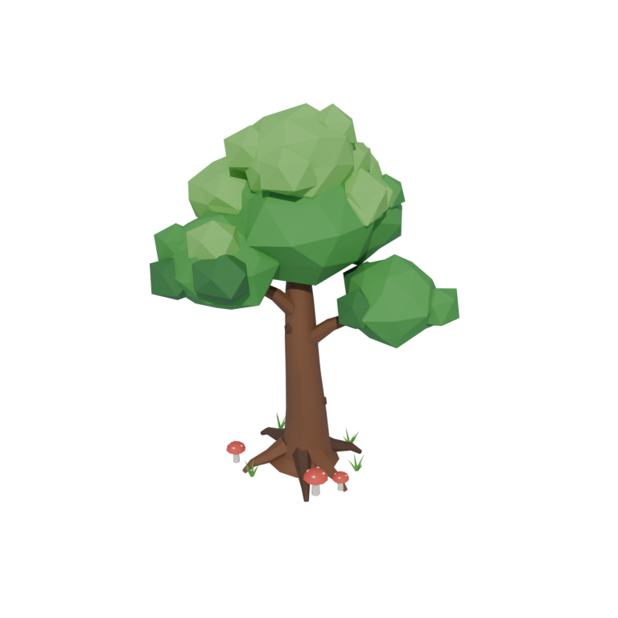
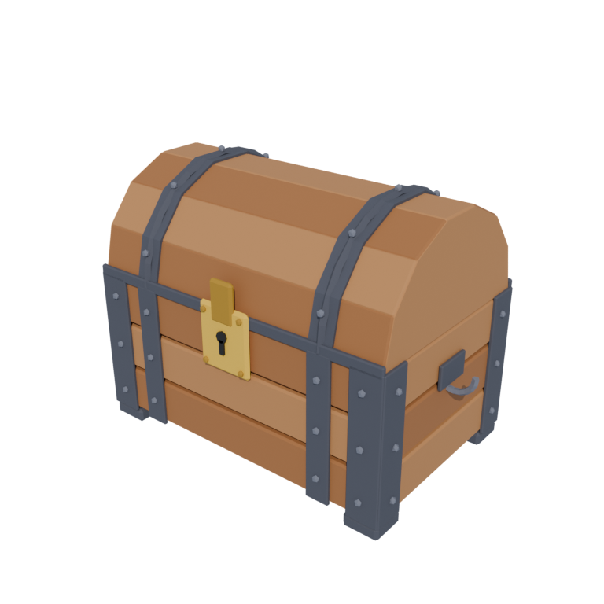
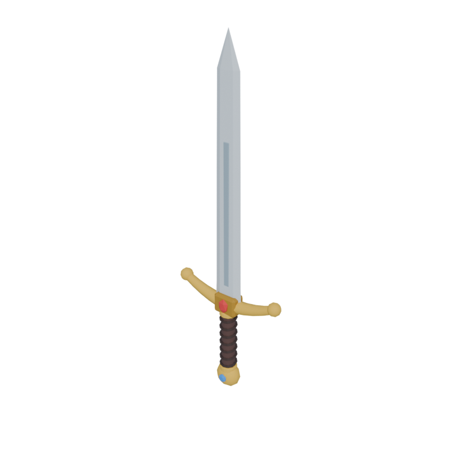

# 3dmodelsTAW

Modèles 3D pour mes jeux Roblox, générés **par code** avec Blender en mode headless (sans interface).

| Arbre | Coffre au trésor | Épée |
|---|---|---|
|  |  |  |

## Installation

Au choix :

- **Blender** (4.x ou 5.x) installé normalement, ou
- **module Python** : `pip install bpy` (Python 3.13 pour bpy 5.x)

## Générer les modèles

```bash
# Tous les modèles
blender -b -P build.py
# ou
python build.py

# Seulement certains, sans rendu d'aperçu (plus rapide)
python build.py sword tree --no-preview
```

Résultats :

- `exports/<modele>/<modele>.fbx` : à importer dans Roblox (texture embarquée)
- `exports/<modele>/<modele>.obj` + `.mtl` + `_palette.png` : alternative OBJ
- `previews/<modele>.png` : aperçu rendu

## Importer dans Roblox Studio

1. **Avatar → Import 3D** (ou *Home → Import 3D*), choisir le `.fbx`.
2. Dans les options, **File Dimensions : Studs** (1 unité Blender = 1 stud).
3. Le modèle arrive en un seul `MeshPart` avec sa texture, origine posée au sol.

## Créer un nouveau modèle

1. Copier `models/_template.py` en `models/mon_modele.py`.
2. Définir la palette `COLORS` et la fonction `build(pal)` avec les primitives de
   `lib/roblox.py` :
   - formes : `box` (avec `bevel_width`), `cylinder`, `cone`, `ico`, `torus`
   - formes libres : `loft` (relie des sections), `tube` (suit un chemin, rayon variable), `ring`
   - retouches : `bevel`, `smooth` (ombrage lisse), `cut_below`, `jitter`
3. Peindre chaque pièce : `pal.paint(objet, "nom_couleur")`.
4. `python build.py mon_modele`

Conventions :

- Z vers le haut dans Blender (converti automatiquement en Y pour Roblox).
- Style low-poly détaillé (biseaux, rivets, planches…), une seule texture palette par modèle → léger et performant.
- Limite Roblox : 20 000 triangles par MeshPart (vérifiée au build).

## Structure

```
build.py           # point d'entrée : génère, exporte, rend les aperçus
lib/roblox.py      # primitives, palette, export FBX/OBJ, rendu
models/*.py        # un fichier par modèle
exports/           # fichiers prêts pour Roblox
previews/          # aperçus PNG
```
